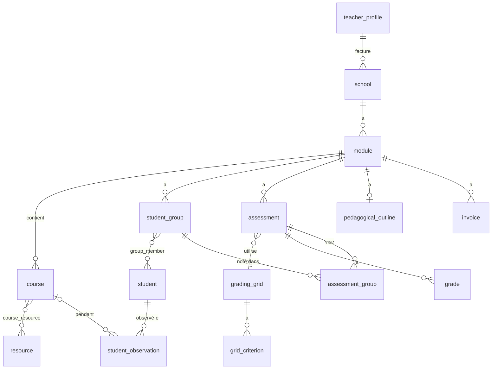

# Modèle de données

> Noms de tables et colonnes **en anglais** `snake_case`. Proposition — finalisée par
> l'Architecte en E1. Volontairement minimal (pas de versioning ni d'audit en MVP).

## Hiérarchie (d'après l'espace Notion de Marie)

`resource` (réutilisable) ──< `course_resource` >── `course` >── `module` >── `school`

Une **ressource** générique est réutilisée dans N **cours** ; chaque cours appartient à
un **module** (école + année) ; le module porte le YCODE, les heures, la trame et la
facturation.

## Tables

| Table                      | Colonnes clés                                                                                                                                                                                                                                                                                                    |
| -------------------------- | ---------------------------------------------------------------------------------------------------------------------------------------------------------------------------------------------------------------------------------------------------------------------------------------------------------------- |
| `resource`                 | title, description, content (markdown), url, **kind** (`resource_kind`, nullable), **audience** (`students` \| `teacher`, défaut `students`), **status** (`resource_status` : `ready` défaut \| `progress` = « à construire »), intent_note, category (= matière), tags[], files(jsonb, bucket `resource-files`) |
| `module`                   | name, school_id, level, year, ycode, total_hours, start_date, first_session_date, end_date, iceberg_state, trame_state, trame_sent_at, billing_state, purchase_order_ref, admin_docs(jsonb), slides_url, student_intro (markdown projeté)                                                                        |
| `course`                   | module_id, title, position (rang 1..N sans trou, US-61), session_date, **start_time**, **end_time** (`time`, nullable), type, learning_objectives[], content_last_updated_at ; clôture privée (US-67) : completion (`course_completion`, nullable), not_covered, next_time, retro_note                           |
| `course_resource`          | course_id, resource_id, role (`primary` \| `secondary`)                                                                                                                                                                                                                                                          |
| `module_resource`          | module_id, resource_id — ressources **retenues** pour un module (unique `module_id + resource_id`), proposées en tête à la liaison de séance (US-55)                                                                                                                                                             |
| `module_expectation`       | module_id, kind (`expectation_kind` : `objective` \| `unit`), label, position, hours (numeric, nullable, unités seulement), modality (`FFP` \| `TDP`, nullable) — attendus de la fiche YNOV (US-53) ; les unités sont des repères indicatifs                                                                     |
| `course_expectation`       | course_id, expectation_id — attendus couverts par une séance (unique `course_id + expectation_id`, US-54)                                                                                                                                                                                                        |
| `student`                  | first_name, last_name, email, photo_url (inutilisée), **photo_path** (US-66 : chemin dans le bucket privé `student-photos`, `<owner_id>/<student_id>/<jeton>.<ext>`), student_number, personal_notes                                                                                                             |
| `student_year`             | student_id, year (année de rentrée, 2025 → « 2025-26 »), scholar_group (promotion de l'année, nullable) — unique `student_id + year` (US-80b). `student.scholar_group` est déprécié : plus lu ni écrit                                                                                                           |
| `student_group`            | module_id, name, type (`tp` \| `td` \| `project`)                                                                                                                                                                                                                                                                |
| `group_member`             | student_group_id, student_id                                                                                                                                                                                                                                                                                     |
| `student_observation`      | module_id, course_id? (`on delete set null`), student_id, tag (`observation_tag`), note — observations privées prises en séance (US-65), jamais projetées, exportées ni envoyées                                                                                                                                 |
| `assessment`               | auto_validated_criterion_ids uuid[] (critères validés d'office, US-82), module_id, title, type, coefficient (ancien, plus lu), **coefficient_override** (coefficient imposé par l'école, « Note de l'école » ; vide = règle de l'école ×1 / ×3, lot 3), date, subject, is_group_grade, max_score (barème, vide = total grille sinon 20), results_sent_at (dernier envoi des résultats par e-mail)                                                           |
| `module_project`           | module_id (unique), title, brief_md, client_context_md — projet fil rouge du module (US-88) ; les jalons / l'oral / l'évaluation individuelle sont des `assessment` rattachés (`assessment.project_id`, `project_role` enum `milestone` \| `oral` \| `individual`, `project_position`)                           |
| `project_theme`            | project_id, title, description_md, position — thèmes au choix du projet fil rouge (US-89)                                                                                                                                                                                                                        |
| `project_theme_assignment` | project_id, student_group_id (unique par projet), theme_id (`on delete cascade`), method (`theme_assignment_method` : `volunteer` \| `draw`), draw_seed, drawn_at — thème d'un groupe (US-89) ; plusieurs groupes peuvent partager un thème                                                                      |
| `assessment_group`         | assessment_id, student_group_id — groupes visés par l'évaluation (≥ 1, paire unique)                                                                                                                                                                                                                             |
| `grading_grid`             | name, description                                                                                                                                                                                                                                                                                                |
| `grid_axis`                | grading_grid_id, label, position — axes d'une grille, chacun avec son sous-total (US-82)                                                                                                                                                                                                                         |
| `grid_criterion`           | grading_grid_id, label, weight, description, axis_id? (`on delete set null`), reference?, is_bonus (hors barème)                                                                                                                                                                                                 |
| `criterion_level`          | grid_criterion_id, points, description, position — paliers d'un critère (unique `(critère, points)`), du plus haut au plus bas ; `grid_criterion.weight` = palier le plus haut (US-81)                                                                                                                           |
| `grade`                    | assessment_id, student_id?, group_id?, value, feedback, is_group_grade, attendance (`attendance_status` : `present` \\                                                                                                                                                                                           | `absent_unexcused` \\ | `absent_excused`), scores(jsonb), criterion_comments(jsonb `{critère: texte}`), strengths?, progress?, feedback? (commentaire libre) |
| `group_grade_member`       | grade_id, student_id (paire unique), attendance, individual_factor (0–2, 1 = note du groupe), justification (obligatoire si facteur ≠ 1) — ajustements individuels d'une note de groupe (US-87)                                                                                                                  |
| `predefined_comment`       | text, category (`positive` \| `negative` \| `advice`), tags[], subject? (matière), grid_criterion_id? (`on delete set null`) + criterion_label? (recopié), use_count, last_used_at — phrases réutilisables (US-84) ; `bump_comment_use(id)` incrémente l'usage                                                   |
| `invoice`                  | module_id, number (`YYYY-NNN`), issued_on, amount_ex_vat, vat_rate, vat_amount, amount_inc_vat, status, purchase_order_ref, sent_at, paid_on, snapshot (jsonb), pdf_path / xml_path (jamais remplis, cf. lot 0)                                                                                                                                                 |
| `pedagogical_outline`      | module_id, generated_at, content(jsonb), status, sent_at, pdf_path                                                                                                                                                                                                                                               |
| `module_document`          | module_id, kind (`school_expectations` \| `outline_sent` \| `external_invoice` \| `slides` \| `training_agreement`), name, path (bucket privé `module-documents`), size_bytes, mime                                                                                                                                                                  |
| `resource_version`         | resource_id, title, description, content, url, category, tags (copie de l'état précédent, déclencheur `resource_snapshot`, 30 max)                                                                                                                                                                               |
| `school`                   | name, siret, address, billing_email, pa_identifier                                                                                                                                                                                                                                                               |
| `teacher_profile`          | legal_name, address, siret, vat_number, activity_number (NDA), bank_details, email                                                                                                                                                                                                                               |

## Autres tables (résumé)

| Table | Rôle |
| --- | --- |
| `school_setting` | réglages par école (unique `school_id`) : absence_rule, email_template, appreciation_max, group_coefficient, individual_coefficient, note_brackets (paliers d'heures), bonus_allowed |
| `assessment_student` | étudiant·es visé·es par une évaluation individuelle / un rattrapage (`assessment.makeup_of_id`) |
| `assessment_expectation` | attendus évalués par une évaluation (unique `assessment_id + module_expectation_id`) |
| `expectation_resource` | lien explicite attendu ↔ ressource (unique `expectation_id + resource_id`) |
| `expectation_dismissal` | ressource écartée pour un attendu (« Ce n'est pas la bonne ») |
| `submission_item` | rendus déposés (fichier ou lien, par étudiant·e ou groupe), `replaced_at` pour l'historique |
| `project_submission` | ancien suivi des rendus (vide en prod, remplacé par `submission_item`) |
| `oral_slot` | ordre de passage des oraux (unique `assessment_id + student_group_id`) |
| `oral_space` | espace de correction d'un oral (lettres, notes, présence en archive) ; `subject_id` = étudiant·e OU groupe selon l'évaluation |
| `progress_review` | point d'étape (relecture non notée ou notée) ; `subject_id` = étudiant·e OU groupe |
| `question`, `question_choice` | banque de questions de QCM |
| `quiz`, `quiz_draw_rule`, `quiz_pool`, `quiz_attempt`, `quiz_claim`, `quiz_class_link` | QCM d'une évaluation, règles de tirage, passages (jeton haché), lien de classe |
| `quiz_question_criterion` | critère(s) de grille d'une question de QCM ouvert |
| `open_review` | relecture d'une copie de QCM à questions ouvertes |
| `quiz_ip_failure` | compteur anti-abus par IP (technique) |
| `resource_question` | questions rattachées à une fiche |
| `course_plan` | déroulé d'une séance (livrable, ordre des ressources) |
| `projection_event` | historique de ce qui a été projeté en séance |
| `appreciation`, `appreciation_phrase` | appréciations par étudiant·e et module ; phrases réutilisables |
| `group_observation` | observations par groupe (comme `student_observation`) |
| `module_student`, `module_student_link` | inscrits d'un module ; lien personnel étudiant·e |
| `module_feedback`, `module_feedback_link` | questionnaire de retour de fin de module |
| `module_retrospective` | rétrospective privée d'un module |
| `module_share_link`, `result_link` | pages publiques partagées (module, résultats) |
| `project_surprise` | événement « surprise » envoyé pendant le projet |
| `invoice_tracking` | facture déposée hors appli : envoyée le / payée le (unique `module_id`) |
| `import_ref` | trace des imports Notion / Moodle (1 374 lignes, plus lue par l'appli) |

## Enums ressources

- `resource_kind` : `course`, `workshop`, `project`, `template`, `answer_key`, `question_bank`,
  `reference`, `teacher_notes` (libellés FR dans `src/lib/resources/kind.ts`).
- `resource_audience` : `students`, `teacher` — `teacher` n'est **jamais** diffusé aux
  étudiant·es (`studentFacing()`).

## Enums carnet de séance (privé)

- `observation_tag` : `relevant_question`, `participation`, `difficulty`, `absent_late`, `other`
  (libellés FR dans `src/lib/notebook/notebook.ts`).
- `course_completion` : `done`, `partial`, `not_done`.
- Garde-fou : `src/lib/notebook/privacy.test.ts` vérifie qu'aucun code d'export PDF, d'e-mail ou
  de présentation ne lit ces données.

## Transverse

- `id uuid primary key default gen_random_uuid()`
- `owner_id uuid not null default auth.uid()` + **RLS** activée + politique `mg_owner_all`
  (rôle `authenticated`, `owner_id = (select auth.uid())`, select/insert/update/delete)
- `created_at` / `updated_at timestamptz not null default now()` + déclencheur `set_updated_at`
  (`extensions.moddatetime(updated_at)`)
- Une nouvelle table appelle `select public.mg_apply_conventions(array['ma_table']);` qui pose
  les trois (RLS, politique, déclencheur). La table doit avoir `owner_id` ET `updated_at`.
- Exception assumée : `quiz_ip_failure` (compteur technique par IP, sans `owner_id`), RLS
  activée sans politique, accessible au seul `service_role`.
- Lot 1 du schéma (`20261206000000`) : `assessment_expectation`, `expectation_dismissal`,
  `expectation_resource` et `quiz_question_criterion` ont reçu `updated_at` (+ politique et
  déclencheur). Les anciennes politiques « `*_owner` » des trois premières sont gardées
  (équivalentes) jusqu'au lot 9.
- `required_notes(total_hours)` : fonction pure (TS) — cf. `src/lib/ynov/notation.ts`

## Simplifications assumées (cf. `DECISIONS.md`)

- Fusion Notion « Séance » / « Activité pédagogique » → `course`.
- Pas de `resource` versioning, pas de `change_log` en MVP.
